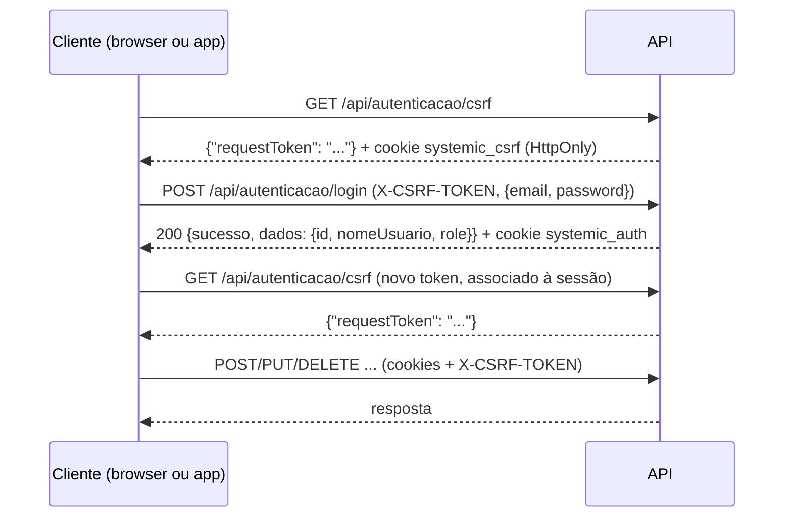

# Referência da API - Systemic PIM

API REST em ASP.NET Core (.NET 10) com 72 ações HTTP em 14 controllers, mais
dois hubs SignalR. Este documento descreve o comportamento implementado em
`back-end/Controllers` e `back-end/Services`.

- [Convenções](#convenções)
- [Fluxo de autenticação com exemplos](#fluxo-de-autenticação-com-exemplos)
- [Perfis e permissões](#perfis-e-permissões)
- [Endpoints](#endpoints)
- [Exemplos de operação](#exemplos-de-operação)
- [Tempo real (SignalR)](#tempo-real-signalr)
- [Notificações](#notificações)
- [Códigos de erro](#códigos-de-erro)

## Convenções

| Item | Valor |
|---|---|
| URL base | `http://localhost:8080/api` (pelo Nginx do Compose, recomendado) ou `http://localhost:5050/api` (direto na API, para diagnóstico) |
| Formato | JSON em `camelCase`; ciclos de referência são ignorados na serialização |
| Autenticação | JWT no cookie HttpOnly `systemic_auth`, emitido pelos endpoints de login |
| CSRF | Toda requisição `POST`, `PUT`, `PATCH` ou `DELETE` (inclusive login e logout) exige o header `X-CSRF-TOKEN`. Sem ele ou com token inválido a API responde HTTP 400 |
| Swagger | `/swagger` (documento `/swagger/v1/swagger.json`, título "Systemic API - PIM IV", versão 2.0), somente com `ASPNETCORE_ENVIRONMENT=Development` |
| Limite de taxa | 600 requisições/min por IP (global) e 60/min por IP nos logins. Excedido: HTTP 429 com header `Retry-After` (segundos) |

### Envelope de resposta

Muitos endpoints respondem com o envelope `RespostaPadraoDTO`:

```json
{
  "sucesso": true,
  "mensagem": "Pedido criado com sucesso!",
  "dados": {},
  "codigoErro": null
}
```

Nem todos os endpoints usam o envelope. Alguns retornam a entidade ou uma lista
diretamente, outros `{ "sucesso": true, "dados": ... }` sem mensagem, e erros
simples podem vir como `{ "message": "..." }`. A coluna "Resposta" da tabela
indica cada caso. Erros de validação de modelo (`[ApiController]`) seguem o
formato `ProblemDetails` do ASP.NET Core (campo `errors`).

### Paginação

Os endpoints marcados com **(pag.)** aceitam `pagina` (a partir de 1) e
`tamanho` (1 a 200; padrão 50 quando só `pagina` é informada). Sem nenhum dos
dois parâmetros, a lista vem completa e sem o header `X-Total-Count`. Com
algum deles, a API ordena por ID, aplica a página e devolve o total no header
`X-Total-Count`. Valores fora da faixa resultam em HTTP 400 com
`{"message":"pagina deve ser maior que 0 e tamanho deve estar entre 1 e 200."}`.

`GET /api/log/sistema` tem paginação própria (veja a tabela).

## Fluxo de autenticação com exemplos



Exemplo com `curl` (use `curl.exe` no PowerShell). Os valores de `requestToken`
e de IDs são ilustrativos; `<SENHA>` é a senha da conta.

```sh
BASE=http://localhost:8080/api

# 1. Token CSRF anterior ao login (grava o cookie antiforgery em cookies.txt)
curl -s -c cookies.txt $BASE/autenticacao/csrf
# {"requestToken":"CfDJ8..."}

# 2. Login (substitua <TOKEN> pelo requestToken recebido)
curl -s -b cookies.txt -c cookies.txt -X POST $BASE/autenticacao/login \
  -H "Content-Type: application/json" \
  -H "X-CSRF-TOKEN: <TOKEN>" \
  -d '{"email":"admin@restaurante.com","password":"<SENHA>"}'
# {"sucesso":true,"mensagem":"Login realizado com sucesso!",
#  "dados":{"id":1,"nomeUsuario":"Administrador","role":"admin"},"codigoErro":null}

# 3. Verificar a sessão (GET não exige CSRF)
curl -s -b cookies.txt $BASE/autenticacao/validar
# {"sucesso":true,"mensagem":"Token válido!","dados":{"id":1,"nome":"Administrador","role":"admin"},"codigoErro":null}

# 4. Obter um novo token CSRF e usar em operações mutáveis
curl -s -b cookies.txt -c cookies.txt $BASE/autenticacao/csrf
```

Falha de credenciais (HTTP 401): `{"sucesso":false,"mensagem":"Ops! Email ou senha incorretos.","codigoErro":"CREDENCIAIS_INVALIDAS"}`.
O servidor devolve a mesma resposta para e-mail inexistente, senha errada e
conta bloqueada.

Regras do login:

- Por e-mail (`/api/autenticacao/login`) ou por CPF (`/api/funcionario/login`).
- Após 5 falhas seguidas, a conta fica bloqueada por 15 minutos
  (`LoginLockoutPolicy`).
- O JWT vale `JWT_EXPIRATION_MINUTES` (padrão 480). Cookie: `HttpOnly`,
  `SameSite=Lax`, `Path=/`; a regra do atributo `Secure` está em
  [CONFIGURACAO.md](CONFIGURACAO.md#cookie-e-proteção-csrf).
- Claims do token: `NameIdentifier` (ID), `Name`, `cpf` e `Role`.
- Os dois logins não verificam `STATUS_FUNCIONARIO`; uma conta marcada como
  `INATIVO` ainda consegue autenticar (veja [CONFIGURACAO.md](CONFIGURACAO.md#limitações-e-operação)).

## Perfis e permissões

| Perfil (`role`) | Nome exibido | O que pode fazer na API |
|---|---|---|
| `employee` | Funcionário | Pedidos, comandas, reservas, notificações; leitura de produtos, mesas e formas de pagamento |
| `admin` | Administrador | Tudo do `employee` e, além disso: produtos, mesas, clientes, formas de pagamento, faturamento, logs, funcionários e backups |
| `owner` | Proprietário | Igual ao `admin`, com a exclusividade de criar/promover/inativar outro `owner` |

Na coluna "Perfil" da tabela, **JWT** isolado significa "qualquer usuário
autenticado"; os demais valores listam as roles aceitas (todas as roles dos
endpoints protegidos são `employee`, `admin` e/ou `owner`). A autorização da
API é independente da navegação da interface.

Somente `owner` pode: criar funcionário com perfil `owner`, promover alguém a
`owner` e inativar um `owner`. Violações retornam HTTP 403.

## Endpoints

### Autenticação (`/api/autenticacao`)

| Método e rota | Perfil | Corpo ou parâmetros | Resposta |
|---|---|---|---|
| `GET /api/autenticacao/csrf` | Público | — | `{requestToken}` e cookie antiforgery `systemic_csrf` |
| `POST /api/autenticacao/login` | Público; CSRF; limite de login | `{email, password}` | Envelope; `dados`: `{id, nomeUsuario, role}`; JWT no cookie |
| `GET /api/autenticacao/validar` | JWT | — | Envelope; `dados`: `{id, nome, role}` lidos das claims; 401 se o token não tiver as claims |
| `POST /api/autenticacao/logout` | Público; CSRF | — | Envelope; expira o cookie `systemic_auth` |

### Backup (`/api/backup`) — `admin`, `owner`

| Método e rota | Corpo ou parâmetros | Resposta |
|---|---|---|
| `POST /api/backup/gerar` | — | `{sucesso, mensagem, dados: {nomeArquivo, caminho, tamanhoBytes, tamanhoExibicao, dataCriacao}}` |
| `GET /api/backup/listar` | — | `{sucesso, dados: [{nomeArquivo, caminho, tamanhoBytes, tamanhoExibicao, dataCriacao}]}`, do mais novo ao mais antigo |
| `GET /api/backup/baixar/{nomeArquivo}` | Nome do ZIP na rota | Arquivo (`application/octet-stream`); 404 `{sucesso:false, mensagem}` se não existir |
| `POST /api/backup/restore` | `multipart/form-data`, campo `Arquivo` (ZIP de até 100 MB) | Envelope; 400 com a mensagem de validação, 500 com `correlationId` em falha interna |

Detalhes de geração e restauração: [CONFIGURACAO.md](CONFIGURACAO.md#backup-e-restauração).

### Clientes (`/api/cliente`) — `admin`, `owner`

| Método e rota | Corpo ou parâmetros | Resposta |
|---|---|---|
| `GET /api/cliente` (pag.) | — | Envelope; `dados`: lista |
| `GET /api/cliente/{id}` | — | Envelope; 404 se não existir |
| `POST /api/cliente` | `{nomeCliente, telefoneCliente?, feedback?}` (telefone até 11 caracteres, feedback até 10) | 201 envelope; 400 sem nome; 409 se o telefone já existe |
| `PUT /api/cliente/{id}` | Mesmo corpo | Envelope; 409 se o telefone pertence a outro cliente |
| `DELETE /api/cliente/{id}` | — | Envelope |

### Comandas (`/api/comanda`) — `employee`, `admin`, `owner`

| Método e rota | Corpo ou parâmetros | Resposta |
|---|---|---|
| `GET /api/comanda` (pag.) | — | `{sucesso, dados}` com comandas, itens, produto, cliente, mesa e pagamentos |
| `GET /api/comanda/{id}` | — | `{sucesso, dados}`; 404 `{sucesso:false, mensagem}` |
| `GET /api/comanda/abertas/todas` (pag.) | — | Envelope; `dados`: comandas abertas (`idComanda`, `dataAberta`, `idMesa`, `numeroMesa`, `idCliente`, `statusComanda`, `valorTotal`) com os itens ainda ativos (`statusItem` diferente de `CONCLUIDO` e `ENTREGUE`) |
| `GET /api/comanda/mesa/{tableNumber}` | Número da mesa | Lista de comandas abertas da mesa; 404 se a mesa não existir |
| `POST /api/comanda` | `{idMesa, idCliente}`; `idCliente` ≤ 0 usa o cliente "Consumidor" | 201 com a entidade `Comanda`; 409 se a mesa já tem comanda aberta; 400 se mesa ou cliente não existem |
| `PUT /api/comanda/{id}` | `{idCliente, idMesa}` (só aplicado se a comanda não está `FECHADA`) | Entidade `Comanda` |
| `POST /api/comanda/{id}/itens` | `{idProduto, qtdProduto, precoUnitarioPago}`; os três são obrigatórios e o preço deve ser maior que 0 | `{message, itemId, novoTotal}`; baixa o estoque e notifica a cozinha |
| `DELETE /api/comanda/{id}/itens/{itemId}` | — | `{message, novoTotal}`; só em comanda `ABERTA`; devolve o estoque |
| `PUT /api/comanda/{id}/pagar` | `{idFormaPagamento, troco}`; o funcionário vem da claim; o valor pago é o total da comanda | Envelope com a comanda; o trigger `trg_fechar_comanda` fecha a comanda e libera a mesa; 400 se já está `FECHADA` |
| `PUT /api/comanda/{id}/fechar` | — | Envelope; registra pagamento com a forma de pagamento de ID `1` e troco 0 |
| `PUT /api/comanda/{id}/inadimplente` | — | Envelope; fecha sem registrar pagamento (fora do faturamento), libera a mesa e grava log `NAO_PAGO`; `dados`: `{idComanda, status:"FECHADA", inadimplente:true}` |
| `DELETE /api/comanda/{id}` | — | `{message}`; remove a comanda e libera a mesa |

### Faturamento (`/api/faturamento`) — `admin`, `owner`

Os parâmetros `dataInicio` e `dataFim` são datas/horas ISO 8601
(`2026-01-01T00:00:00`).

| Método e rota | Corpo ou parâmetros | Resposta |
|---|---|---|
| `GET /api/faturamento` | — | Envelope; resumo do dia UTC: `{dataInicio, dataFim, receita, despesas, lucro}` |
| `GET /api/faturamento/relatorio` | Query `dataInicio`, `dataFim` | `{dataInicio, dataFim, receita, despesas, lucro}` (sem envelope), via `sp_relatorio_faturamento`; 400 se `dataFim` < `dataInicio` |
| `GET /api/faturamento/produtos-mais-vendidos` | — | Lista `{idProduto, nomeProduto, quantidadeVendida}`, via a view `vw_produtos_mais_vendidos` |
| `GET /api/faturamento/receita-por-forma` | Query `dataInicio`, `dataFim` | Lista `{formaPagemento, total}` (a grafia `formaPagemento` é a do código) |
| `GET /api/faturamento/despesa-por-categoria` | Query `dataInicio`, `dataFim` | Lista `{categoria, total}` |
| `POST /api/faturamento/despesa` | `{descricaoDespesa, valorDespesa, categoriaDespesa, idFormaPagamento}`; a data é definida pelo servidor | 201 com a entidade `Despesa`; 400 sem descrição ou com valor ≤ 0 |
| `GET /api/faturamento/despesas` | Query `dataInicio`, `dataFim` | Lista de despesas com a forma de pagamento |

### Formas de pagamento (`/api/formapagamento`)

| Método e rota | Perfil | Corpo ou parâmetros | Resposta |
|---|---|---|---|
| `GET /api/formapagamento` | `employee`, `admin`, `owner` | — | `{sucesso, dados}` |
| `GET /api/formapagamento/{id}` | `employee`, `admin`, `owner` | — | `{sucesso, dados}`; 404 |
| `POST /api/formapagamento` | `admin`, `owner` | `{nomeFormaPagamento}` (até 20 caracteres) | 201 com a entidade; 409 se o nome já existe |
| `PUT /api/formapagamento/{id}` | `admin`, `owner` | `{nomeFormaPagamento}` | Entidade atualizada; 409 se duplicado |
| `DELETE /api/formapagamento/{id}` | `admin`, `owner` | — | `{message}` |

### Funcionários (`/api/funcionario`)

| Método e rota | Perfil | Corpo ou parâmetros | Resposta |
|---|---|---|---|
| `POST /api/funcionario/login` | Público; CSRF; limite de login | `{cpfFuncionario, senha}` | `{idFuncionario, nomeFuncionario}` (sem envelope); JWT no cookie. Erros: `{message}` com tentativas restantes ou tempo de bloqueio |
| `GET /api/funcionario` (pag.) | `admin`, `owner` | — | Envelope; `dados`: lista de `{idFuncionario, nomeFuncionario, emailFuncionario, cpfFuncionario, telefoneFuncionario, cargoFuncionario, role, perfil, statusFuncionario}`, sem senha |
| `GET /api/funcionario/{id}` | `admin`, `owner` | — | Envelope; 404 |
| `POST /api/funcionario` | `admin`, `owner` | `{nomeFuncionario, cpfFuncionario, emailFuncionario, cargoFuncionario, role, telefoneFuncionario, senha}`; nome, CPF e senha são obrigatórios; `role` aceita `employee`, `admin`, `owner` (ou "Administrador", "Proprietário"); qualquer outro valor vira `employee` | 201 envelope sem senha; 400 CPF repetido; 409 e-mail repetido; 403 ao criar `owner` sem ser `owner` |
| `PUT /api/funcionario/{id}` | `admin`, `owner` | Mesmo corpo; o CPF não é alterado; senha vazia mantém a atual; e-mail vazio mantém o atual | Envelope sem senha; 409 e-mail repetido; 403 ao promover a `owner` sem ser `owner` |
| `DELETE /api/funcionario/{id}` | `admin`, `owner` | — | Envelope; marca `statusFuncionario = INATIVO` (não apaga); 403 ao inativar um `owner` sem ser `owner` |

### Health check (`/api/healthcheck`) — público

| Método e rota | Resposta |
|---|---|
| `GET /api/healthcheck` | 200; envelope com `mensagem` "API está funcionando perfeitamente!" e `dados: {status: "SAUDÁVEL"}` |
| `GET /api/healthcheck/database` | 200; envelope com `dados: {status: "CONECTADO", banco: "SQL Server", timestamp}`. Em falha: 503, `codigoErro: "DATABASE_INDISPONIVEL"` e `dados: {correlationId}`; o detalhe só vai para o log |
| `GET /api/healthcheck/info` | 200; envelope com `dados: {status: "ok"}` |

O Compose usa `GET /api/healthcheck` nos health checks da API.

### Logs (`/api/log`) — `admin`, `owner`

| Método e rota | Corpo ou parâmetros | Resposta |
|---|---|---|
| `GET /api/log/sistema` | Query `pagina` (padrão 1), `tamanho` (padrão 50, sem teto validado), `filtro` (texto contido no tipo ou na descrição) | `{sucesso, total, pagina, dados}`, mais recentes primeiro |
| `POST /api/log/registrar` | `{tipoLog, descricaoLog, dadoAnterior?, dadoNovo?}`; o usuário gravado vem do token (o campo `usuarioLog` do corpo é ignorado) | Envelope; `dados`: `{id}`; 400 sem tipo ou descrição |
| `GET /api/log/comanda/{idComanda}` | — | `{sucesso, dados}` |

### Mesas (`/api/mesa`)

| Método e rota | Perfil | Corpo ou parâmetros | Resposta |
|---|---|---|---|
| `GET /api/mesa` (pag.) | `employee`, `admin`, `owner` | — | Envelope; `dados`: lista |
| `GET /api/mesa/{id}` | `employee`, `admin`, `owner` | — | Envelope; 404 |
| `POST /api/mesa` | `admin`, `owner` | `{numeroMesa, capacidadeMesa, statusMesa?}`; ambos maiores que 0 | 201 envelope; 409 se o número já existe |
| `PUT /api/mesa/{id}` | `admin`, `owner` | `{numeroMesa, capacidadeMesa, statusMesa}`; `statusMesa` deve ser `DISPONIVEL` ou `OCUPADA` | Entidade `Mesa`; 400 ao liberar mesa com comanda aberta; 409 se o número já existe |
| `DELETE /api/mesa/{id}` | `admin`, `owner` | — | `{message}` |

### Notificações (`/api/notificacoes`) — `employee`, `admin`, `owner`

Cada funcionário só enxerga e altera as próprias notificações.

| Método e rota | Corpo ou parâmetros | Resposta |
|---|---|---|
| `GET /api/notificacoes?limit=50` | `limit` de 1 a 100 (padrão 50); fora disso, 400 | Envelope; `dados`: `{items: [{id, type, title, message, href, createdAt, readAt}], unreadCount}` |
| `PATCH /api/notificacoes/{id}/lida` | — | 204; 404 se não for do funcionário |
| `POST /api/notificacoes/marcar-todas-lidas` | — | Envelope; `dados`: `{atualizadas}` |

### Pedidos (`/api/pedidos`) — `employee`, `admin`, `owner`

Um pedido é uma comanda com seus itens.

| Método e rota | Corpo ou parâmetros | Resposta |
|---|---|---|
| `GET /api/pedidos` (pag.) | — | Envelope; `dados`: comandas com itens, produto, mesa e cliente |
| `GET /api/pedidos/{id}` | — | Envelope; 404 `PEDIDO_NAO_ENCONTRADO` |
| `POST /api/pedidos` | `{idMesa, itens: [{idProduto, qtdProduto, precoUnitarioPago}], idCliente?}`. `idMesa` é procurado primeiro como ID e, se não existir, como número da mesa. `precoUnitarioPago` ≤ 0 usa o preço do produto. `idCliente` só é usado quando a mesa não tem comanda aberta | Com comanda aberta: 200 `Pedido adicionado à comanda existente com sucesso!`. Sem comanda aberta: cria a comanda e responde 201 (exige `idCliente` válido, senão 400 `CLIENTE_INVALIDO`). Em ambos, baixa o estoque e emite `PedidoNovo` e notificações |
| `PUT /api/pedidos/{id}` | Mesmo corpo | Envelope; substitui todos os itens, devolvendo e baixando o estoque |
| `PUT /api/pedidos/{id}/status` | `{status}`: `preparing`, `in_progress` ou `completed` (atualizam o status dos itens para `PREPARAR`, `PREPARANDO`, `CONCLUIDO`) ou `ABERTA`. `FECHADA` é recusado com `USE_PAGAMENTO` | Envelope; `completed` emite `PedidoPronto` e a notificação `pedido_pronto` |
| `DELETE /api/pedidos/{id}` | — | Envelope; remove a comanda e libera a mesa |

### Produtos (`/api/produto`)

| Método e rota | Perfil | Corpo ou parâmetros | Resposta |
|---|---|---|---|
| `GET /api/produto` (pag.) | `employee`, `admin`, `owner` | — | Envelope; `dados`: lista de produtos com `categoria` calculada |
| `GET /api/produto/{id}` | `employee`, `admin`, `owner` | — | Envelope; 404 |
| `POST /api/produto` | `admin`, `owner` | `{nomeProduto, descricaoProduto?, precoProduto, qtdEstoque, estoqueMinimo, statusProduto?, categoria?}`; nome obrigatório (até 45 caracteres); `estoqueMinimo` ≤ 0 vira 5; `statusProduto` padrão `DISPONIVEL`; também aceita `categoriaProduto` | 201 envelope |
| `PUT /api/produto/{id}` | `admin`, `owner` | Mesmo corpo; sobrescreve todos os campos | Envelope; pode gerar `estoque_baixo` |
| `DELETE /api/produto/{id}` | `admin`, `owner` | — | Envelope |
| `PUT /api/produto/{id}/ajustar-estoque` | `admin`, `owner` | `{tipo, quantidade, motivo}`; `tipo` `ADICIONAR` soma e qualquer outro valor subtrai; `motivo` obrigatório | Envelope; `dados`: `{quantidadeAnterior, quantidadeNova, motivo, produto}` via `sp_ajustar_estoque`; 400 se o estoque não bastar |

Categorias: a interface usa `Entradas`, `Bebidas`, `Sobremesas`, `Carnes`,
`Peixes`, `Massas` e `Saladas`. No banco ficam `ENTRADA`, `BEBIDA`,
`SOBREMESA` e `PRINCIPAL` (os quatro últimos nomes viram `PRINCIPAL`).

### Reservas (`/api/reserva`) — `employee`, `admin`, `owner`

| Método e rota | Corpo ou parâmetros | Resposta |
|---|---|---|
| `GET /api/reserva` (pag.) | — | Envelope; `dados`: `{idReserva, idCliente, idMesa, numeroMesa, nomeCliente, dataReserva, statusReserva}` |
| `POST /api/reserva` | `{nomeCliente, numeroMesa, dataReserva}`. A data deve ser futura; a mesa não pode ter outra reserva não cancelada em até 2 h antes ou depois; o cliente é criado se o nome não existir | 200 envelope com a reserva (`statusReserva: DISPONIVEL`); 400 em data passada, mesa inexistente ou conflito |
| `DELETE /api/reserva/{id}` | — | Envelope; não apaga a linha: muda `statusReserva` para `CANCELADA`; 400 se já cancelada |

## Exemplos de operação

Os exemplos assumem os cookies do [fluxo de autenticação](#fluxo-de-autenticação-com-exemplos)
e um novo `X-CSRF-TOKEN` (`<TOKEN>`).

Abrir uma comanda na mesa 3 com o cliente padrão:

```sh
curl -s -b cookies.txt -X POST $BASE/comanda \
  -H "Content-Type: application/json" -H "X-CSRF-TOKEN: <TOKEN>" \
  -d '{"idMesa":3,"idCliente":0}'
# 201 {"idComanda":121,"dataAberta":"...","statusComanda":"ABERTA","idMesa":3,"idCliente":1,"valorTotal":0,...}
```

Lançar um pedido (preço `0` usa o preço cadastrado do produto):

```sh
curl -s -b cookies.txt -X POST $BASE/pedidos \
  -H "Content-Type: application/json" -H "X-CSRF-TOKEN: <TOKEN>" \
  -d '{"idMesa":3,"itens":[{"idProduto":4,"qtdProduto":2,"precoUnitarioPago":0}]}'
# 200 {"sucesso":true,"mensagem":"Pedido adicionado à comanda existente com sucesso!","dados":{...},"codigoErro":null}
```

Avançar o status na cozinha e pagar:

```sh
curl -s -b cookies.txt -X PUT $BASE/pedidos/121/status \
  -H "Content-Type: application/json" -H "X-CSRF-TOKEN: <TOKEN>" \
  -d '{"status":"in_progress"}'

curl -s -b cookies.txt -X PUT $BASE/comanda/121/pagar \
  -H "Content-Type: application/json" -H "X-CSRF-TOKEN: <TOKEN>" \
  -d '{"idFormaPagamento":1,"troco":0}'
# {"sucesso":true,"mensagem":"Pagamento registrado e comanda fechada","dados":{...},"codigoErro":null}
```

Relatório financeiro e lista paginada:

```sh
curl -s -b cookies.txt "$BASE/faturamento/relatorio?dataInicio=2026-01-01T00:00:00&dataFim=2026-12-31T23:59:59"
# {"dataInicio":"2026-01-01T00:00:00","dataFim":"2026-12-31T23:59:59","receita":1250.50,"despesas":300.00,"lucro":950.50}

curl -si -b cookies.txt "$BASE/produto?pagina=1&tamanho=20"
# ... X-Total-Count: 18 ...
```

Um exemplo TypeScript do cliente com cookies e CSRF está em
[EXEMPLO_INTEGRACAO_REACT.ts](EXEMPLO_INTEGRACAO_REACT.ts).

## Tempo real (SignalR)

Os dois hubs exigem sessão autenticada (`[Authorize]`, sem restrição de role)
e leem o JWT do cookie `systemic_auth`. Clientes web e mobile conectam com
`withCredentials: true` e reconexão automática. Atrás do Nginx, a rota `/hubs/`
é encaminhada com suporte a WebSocket.

### `/hubs/cozinha`

O servidor transmite para **todos** os clientes conectados (`Clients.All`):

| Evento | Payload | Emitido quando |
|---|---|---|
| `PedidoNovo` | `{idComanda, idMesa, itens: [{idProduto, qtdProduto, statusItem}], timestamp}` | Pedido criado ou item adicionado à comanda |
| `PedidoEmPreparo` | `{idComanda, idMesa, timestamp}` | Status do pedido vai para `in_progress` |
| `PedidoPronto` | `{idComanda, idMesa, timestamp}` | Status do pedido vai para `completed` |
| `ComandaAtualizada` | `{idComanda, idMesa, novoStatus, timestamp}` | Criação, edição, pagamento, fechamento, remoção e mudança de status de comandas e pedidos |
| `UsuarioConectado` / `UsuarioDesconectado` | Texto com o ID da conexão | Conexão aberta ou encerrada |

A interface web reage a `PedidoNovo`, `PedidoEmPreparo`, `PedidoPronto` e
`ComandaAtualizada` recarregando as comandas.

O hub também expõe métodos invocáveis pelo cliente (`NotificarPedidoNovo`,
`NotificarPedidoPronto`, `NotificarPedidoEmPreparo`, `AtualizarStatusComanda`)
que retransmitem eventos equivalentes a todos os clientes. Qualquer usuário
autenticado pode invocá-los.

### `/hubs/notificacoes`

Cada conexão entra no grupo `employee:<id>`. O evento `NotificationCreated`
leva `{id, type, title, message, href, createdAt, readAt}` e só chega ao
funcionário destinatário.

## Notificações

A API grava uma notificação por funcionário **ativo** (`ATIVO`) cujo perfil
esteja na lista do evento, na tabela `NOTIFICACAO`, e depois tenta entregá-la
pelo SignalR. Se a entrega falha, a notificação continua disponível em
`GET /api/notificacoes`.

| `type` | Destinatários | Origem | Link (`href`) |
|---|---|---|---|
| `pedido_novo` | `employee`, `admin`, `owner` | `POST /api/pedidos`; `POST /api/comanda/{id}/itens` | `/orders` |
| `pedido_pronto` | `employee`, `admin`, `owner` | `PUT /api/pedidos/{id}/status` com `completed` | `/orders` |
| `estoque_baixo` | `admin`, `owner` | Estoque que estava acima do mínimo passa a ficar igual ou abaixo (pedidos, itens de comanda, edição de produto, ajuste de estoque) | `/inventory` |
| `estoque_reabastecido` | `admin`, `owner` | `PUT /api/produto/{id}/ajustar-estoque` com `ADICIONAR` | `/inventory` |
| `reserva_criada` | `employee`, `admin`, `owner` | `POST /api/reserva` | `/reservations` |
| `reserva_cancelada` | `employee`, `admin`, `owner` | `DELETE /api/reserva/{id}` | `/reservations` |

Não há push remoto fora dos clientes: a web e o app recebem os eventos
enquanto estão conectados e consultam a central periodicamente (a cada 30 s).

## Códigos de erro

Valores de `codigoErro` encontrados no código:

| Código | HTTP | Onde |
|---|---|---|
| `CREDENCIAIS_INVALIDAS` | 401 | Login por e-mail |
| `EMAIL_SENHA_VAZIOS` | 400 | Login por e-mail |
| `MESA_INVALIDA` | 400 | `POST /api/pedidos` |
| `CLIENTE_INVALIDO` | 400 | `POST /api/pedidos` sem comanda aberta |
| `QUANTIDADE_INVALIDA` | 400 | `POST /api/pedidos` |
| `PRODUTO_NAO_ENCONTRADO` | 400 | `POST /api/pedidos` |
| `PRODUTO_INDISPONIVEL` | 400 | Pedidos (produto com status diferente de `DISPONIVEL`) |
| `ESTOQUE_INSUFICIENTE` | 400 | `POST /api/pedidos` |
| `PEDIDO_NAO_ENCONTRADO` | 404 | Pedidos |
| `STATUS_INVALIDO` | 400 | `PUT /api/pedidos/{id}/status` |
| `USE_PAGAMENTO` | 400 | `PUT /api/pedidos/{id}/status` com `FECHADA` |
| `DATABASE_INDISPONIVEL` | 503 | `GET /api/healthcheck/database` |

Falhas internas de backup e de comandas abertas respondem HTTP 500 com um
`correlationId` que identifica a entrada correspondente no log da API.
