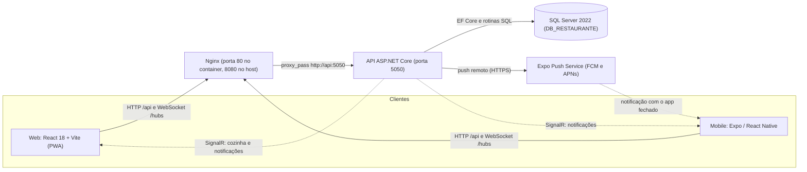
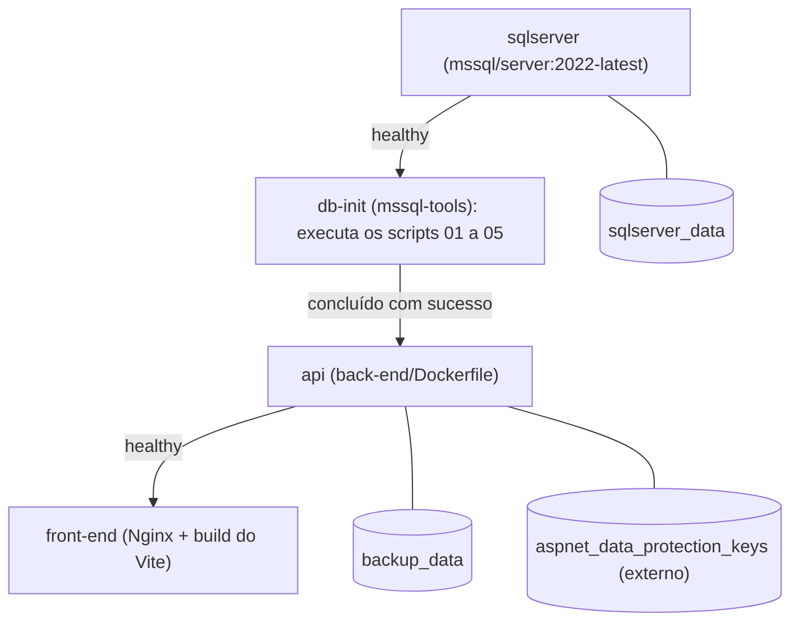
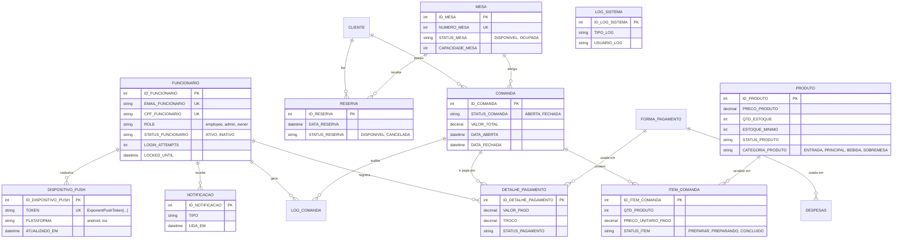
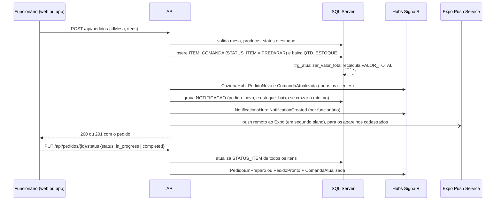

# Arquitetura - Systemic PIM

Sistema de gerenciamento de restaurante composto por uma interface web (PWA),
um aplicativo mobile, uma API REST e SQL Server. A comunicação principal é
cliente -> API ASP.NET Core -> Entity Framework Core -> SQL Server. Web e
mobile também usam SignalR para atualizações em tempo real.

## Visão geral



O navegador e o app usam sempre a mesma origem do front-end (`/api` e
`/hubs`); o Nginx encaminha as chamadas para a API dentro da rede do Docker.
A porta 5050 também é publicada pelo Compose, mas serve apenas a diagnóstico.

## Tecnologias e componentes

| Componente | Tecnologia |
|---|---|
| Interface web | React 18, TypeScript, Vite, React Router 7 (`react-router`), TanStack Query, Tailwind CSS, componentes Radix/shadcn, Recharts |
| App mobile | Expo SDK 58, React Native, Expo Router, TypeScript, `expo-sqlite` (cache), `expo-notifications` |
| API | ASP.NET Core/.NET 10, Entity Framework Core 10, Swashbuckle (Swagger) |
| Banco de dados | SQL Server 2022 |
| Atualizações em tempo real | SignalR (`@microsoft/signalr` no web e no mobile) |
| Execução em contêineres | Docker Compose e Nginx |
| Aplicação web instalável | PWA com service worker (`vite-plugin-pwa`) |
| Testes | xUnit + FluentAssertions (.NET); Vitest + Testing Library (web) |
| CI/CD | GitHub Actions: `ci.yml` e `cd.yml` |

### Contêineres



O Compose da raiz coordena SQL Server, inicialização do banco, API e interface.
O `db-init` executa os scripts SQL antes da API. O front-end é servido pelo
Nginx, que repassa `/api/` e `/hubs/` para `api:5050`. Pré-requisito e demais
detalhes: [CONFIGURACAO.md](CONFIGURACAO.md) e [DEPLOY.md](DEPLOY.md).

## Organização do código

```text
back-end/
  Controllers/       Endpoints HTTP por domínio (15 controllers)
    Backup/          DTO de upload da restauração
  Data/              AppDbContext e mapeamentos do EF Core
  DTOs/              Modelos de entrada e saída
  Helpers/           Carregamento do .env e fuso horário de Brasília
  Hubs/              Hubs SignalR: CozinhaHub e NotificationsHub
  Models/            Entidades persistidas
  Scripts/           Schema, procedures/views, constraints, notificações, seed e migrações
  Services/          Regras de negócio, autenticação, notificações, paginação
    Backup/          Restauração e assinatura HMAC dos backups
  Program.cs         Inicialização, middleware e configuração HTTP

front-end/
  public/            Ícones, favicon e offline.html
  src/
    components/      Componentes compartilhados, layout e componentes de UI
    contexts/        Autenticação, dados do restaurante e acessibilidade
    hooks/           Hooks de interface, incluindo SignalR
    lib/             RBAC e utilitários
    pages/           Telas da aplicação
    services/        Comunicação HTTP com a API
    test/            Testes Vitest
    App.tsx          Rotas e providers
    sw.ts            Service worker
  nginx.conf         Proxy /api e /hubs, cabeçalhos de segurança

mobile/
  app/               Rotas do Expo Router (login, abas, comanda, pedido, relatórios...)
  src/               Componentes, contextos, hooks, serviços (api, http, cache, notificações) e tema

tests/               Testes automatizados .NET (unitários e de integração)
docs/                Guias e exemplo de integração
.github/workflows/   CI e CD
```

## Módulos da interface web

| Rota | Área | Acesso |
|---|---|---|
| `/login` | Autenticação | Pública |
| `/dashboard` | Visão geral | `admin`, `owner` |
| `/orders` | Pedidos | `employee`, `admin`, `owner` |
| `/tabs` | Comandas | `employee`, `admin`, `owner` |
| `/inventory` | Estoque e produtos | `admin`, `owner` |
| `/reservations` | Reservas | `employee`, `admin`, `owner` |
| `/reports` | Faturamento e relatórios | `admin`, `owner` |
| `/users` | Funcionários | `admin`, `owner` |
| `/audit` | Auditoria | `admin`, `owner` |
| `/backup` | Backup e restauração | `admin`, `owner` |
| `/accessibility` | Acessibilidade | `employee`, `admin`, `owner` |

As páginas protegidas aguardam a validação da sessão no servidor. A interface
controla a navegação, mas a autorização efetiva também é aplicada pela API. A
matriz de acesso por endpoint está em [API.md](API.md#endpoints).

Todas as telas ficam em carregamento sob demanda (`lazy`). O sino de
notificações fica no cabeçalho do layout (`NotificationsBell`) e o widget
VLibras (Libras) é carregado em todas as páginas.

## App mobile

Aplicativo Expo para Android e iOS (veja [mobile/README.md](../mobile/README.md)).
Usa os mesmos endpoints da web, com cookie `systemic_auth` e CSRF.

| Tela | Rota do app | Acesso |
|---|---|---|
| Login | `/login` | Pública |
| Mesas (abas) | `/(tabs)/tables` | Todos os perfis |
| Pedidos (abas; atualiza a cada 15 s ao ganhar foco) | `/(tabs)/orders` | Todos os perfis |
| Reservas (abas) | `/(tabs)/reservations` | Todos os perfis |
| Resumo financeiro (abas) | `/(tabs)/dashboard` | `admin`, `owner` |
| Produtos e estoque (abas) | `/(tabs)/products` | `admin`, `owner` |
| Detalhe da comanda | `/comanda/[id]` | Todos os perfis |
| Novo pedido | `/pedido/novo` | Todos os perfis |
| Relatórios, Usuários e Auditoria (abertos a partir de Resumo) | `/reports`, `/users`, `/audit` | `admin`, `owner` |
| Acessibilidade (temas Claro, Escuro e Alto contraste) | `/accessibility` | Todos os perfis |

O app mantém um cache SQLite local (`systemic-mobile.db`) de mesas, produtos,
comandas, pedidos e reservas, que é limpo ao sair da conta, e guarda a
preferência de tema no mesmo banco.

## API e persistência

Os 15 controllers organizam autenticação, backups, clientes, comandas,
faturamento, formas de pagamento, funcionários, health checks, logs, mesas,
notificações, dispositivos de push, pedidos, produtos e reservas. A lista de rotas, métodos,
parâmetros e respostas está em [API.md](API.md).

Os controllers delegam a regra de negócio a serviços injetados por interface
(`I*Service` em `back-end/Services`), que usam o `AppDbContext`. As listas
aceitam paginação opcional por `pagina` e `tamanho`.

### Modelo de dados

O banco `DB_RESTAURANTE` tem 14 tabelas: `FUNCIONARIO`, `CLIENTE`, `MESA`,
`FORMA_PAGAMENTO`, `PRODUTO`, `RESERVA`, `COMANDA`, `ITEM_COMANDA`,
`DETALHE_PAGAMENTO`, `DESPESAS`, `LOG_COMANDA`, `LOG_SISTEMA`, `NOTIFICACAO` e
`DISPOSITIVO_PUSH`.



Os valores de status listados são os que a API grava. Os scripts de seed
também usam `ENTREGUE` e `PRONTO` (itens) e `CONCLUIDA`, `CONFIRMADA` e
`PENDENTE` (reservas), que a API não grava. `LOG_SISTEMA` não tem chave
estrangeira.

Os scripts SQL também definem:

- Triggers: `trg_abrir_comanda` marca a mesa como `OCUPADA` ao abrir uma
  comanda; `trg_atualizar_valor_total` recalcula `VALOR_TOTAL` quando os itens
  mudam; `trg_fechar_comanda` fecha a comanda e libera a mesa após um
  pagamento.
- Procedures `sp_fechar_comanda`, `sp_relatorio_faturamento` e
  `sp_ajustar_estoque`. A API usa as duas últimas; `sp_fechar_comanda` não é
  chamada pelo código.
- Views `vw_comandas_abertas` e `vw_produtos_mais_vendidos`.
- Índices únicos: um e-mail por funcionário (`IX_FUNCIONARIO_EMAIL`), uma
  comanda aberta por mesa (`UX_COMANDA_MESA_ABERTA`), telefone de cliente
  (`UX_CLIENTE_TELEFONE`) e número de mesa (`UX_MESA_NUMERO`) únicos.

O esquema é evoluído pelos scripts SQL versionados; migrations do Entity
Framework Core não são usadas. A ordem de inicialização e os nomes dos scripts
estão no guia de [configuração](CONFIGURACAO.md#banco-de-dados-e-scripts).

### Ciclo de vida da comanda e da mesa

```mermaid
stateDiagram-v2
    [*] --> ABERTA: POST /api/comanda ou POST /api/pedidos sem comanda aberta (mesa passa a OCUPADA)
    ABERTA --> ABERTA: itens adicionados/removidos (total recalculado por trigger)
    ABERTA --> FECHADA: PUT .../pagar ou .../fechar (insere DETALHE_PAGAMENTO; trigger libera a mesa)
    ABERTA --> FECHADA: PUT .../inadimplente (sem pagamento; mesa liberada)
    ABERTA --> [*]: DELETE da comanda (mesa liberada)
    FECHADA --> [*]
```



### Fluxo de criação de pedidos

`POST /api/pedidos` recebe `idMesa` e `itens`. Quando há uma comanda aberta
para a mesa, os itens são adicionados a ela. Para criar um pedido sem comanda
aberta, o DTO também aceita `idCliente`, que precisa identificar um cliente
válido. A tela de pedidos exige uma comanda aberta; a abertura de comanda é
uma operação separada em `POST /api/comanda`.



Os itens avançam por `PREPARAR`, `PREPARANDO` e `CONCLUIDO`. O pagamento
(`PUT /api/comanda/{id}/pagar`) fecha a comanda; o pedido não pode ser fechado
por `PUT /api/pedidos/{id}/status`.

## Sessão e segurança

O login aceita email ou CPF. A API entrega o JWT em cookie HttpOnly
`systemic_auth`; a interface usa antiforgery por `X-CSRF-TOKEN` nas
requisições mutáveis. A sessão e o perfil são revalidados no servidor ao
inicializar o cliente (web e mobile). CORS permite credenciais apenas para as
origens configuradas.

Novos hashes de senha usam PBKDF2-SHA256 com salt aleatório e 600.000
iterações; hashes legados continuam aceitos e são atualizados após login
bem-sucedido. Os fluxos de login por email e CPF usam a mesma política de
bloqueio (5 falhas, 15 minutos). Detalhes de configuração estão em
[CONFIGURACAO.md](CONFIGURACAO.md#autenticação-senha-e-bloqueio).

## Atualizações em tempo real

- `/hubs/cozinha` (autenticado): transmite a todos os clientes os eventos
  `PedidoNovo`, `PedidoEmPreparo`, `PedidoPronto` e `ComandaAtualizada`. A web
  recarrega as comandas ao recebê-los.
- Push remoto (app mobile fechado): a API envia cada notificação também ao Expo Push
  Service, que entrega por FCM ou APNs. Veja [PUSH_NOTIFICATIONS.md](PUSH_NOTIFICATIONS.md).
- `/hubs/notificacoes` (autenticado): cada conexão entra no grupo do próprio
  funcionário e recebe `NotificationCreated`. Web e mobile usam este hub.

O cliente web tenta reconectar sozinho (esperas de 0, 2, 10 e 30 s e nova
tentativa a cada 5 s após queda) e o contexto do restaurante consulta as
comandas a cada 60 s como contingência quando o SignalR está habilitado, mas
desconectado. A central de notificações da web e a do mobile consultam a API a
cada 30 s. O mobile reconecta com esperas de 0, 2, 5, 10 e 30 s.

Payloads e destinatários: [API.md](API.md#tempo-real-signalr).

## PWA, backup e implantação

O service worker pré-armazena recursos estáticos do front-end; chamadas à API
não são armazenadas em cache. Sem rede, as navegações recebem a página offline
(`offline.html`).

Os backups são ZIPs assinados com HMAC e guardados no caminho configurado por
`BACKUP_PATH`. No Compose, o caminho padrão `/app/backups` usa o volume
persistente `backup_data`. Restaurar exige uma assinatura válida, valida as
entradas do arquivo e cria um backup de segurança antes de aplicar os dados.

O repositório publica imagens Docker da API e do front-end no GHCR (CD), mas
não implanta em nuvem. Em produção, use TLS, configure CORS para origens
confiáveis e informe somente IPs de proxy confiáveis em
`FORWARDED_HEADERS_KNOWN_PROXIES`. A configuração atual do cookie pressupõe que
a interface e a API sejam servidas pelo mesmo site. Veja [DEPLOY.md](DEPLOY.md).
