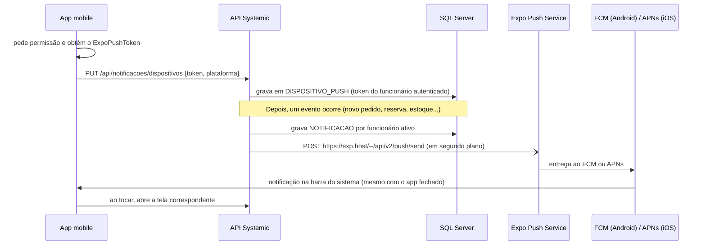

# Notificações push (app fechado) - Systemic PIM

Este guia explica como o push remoto funciona no projeto e **onde obter e configurar as credenciais**
(Firebase/FCM, Apple/APNs e Expo). Sem essas credenciais o app continua funcionando: ele recebe
notificações em tempo real por SignalR enquanto está aberto e consulta a central a cada 30 s.
O push é o que entrega a notificação **com o app fechado**.

- [Como funciona](#como-funciona)
- [O que já está pronto no código](#o-que-já-está-pronto-no-código)
- [Onde configurar as credenciais](#onde-configurar-as-credenciais)
- [Android: Firebase (FCM)](#android-firebase-fcm)
- [iOS: Apple (APNs)](#ios-apple-apns)
- [Segurança extra no Expo (opcional)](#segurança-extra-no-expo-opcional)
- [Gerar o app e testar](#gerar-o-app-e-testar)
- [Comportamento e limites](#comportamento-e-limites)
- [Solução de problemas](#solução-de-problemas)

## Como funciona



- O app registra o token **depois do login** e o remove **no logout**.
- A API envia o push em segundo plano, sem atrasar a requisição que gerou o evento. Se o Expo estiver
  fora do ar, a notificação continua disponível na central do app e o erro vai para o log.
- Os mesmos eventos e destinatários da central valem para o push (veja
  [API.md](API.md#notificações)): `pedido_novo`, `pedido_pronto`, `estoque_baixo`,
  `estoque_reabastecido`, `reserva_criada` e `reserva_cancelada`.

## O que já está pronto no código

| Parte | Onde |
|---|---|
| Tabela de dispositivos | `back-end/Scripts/05-create-push-devices.sql` (`DISPOSITIVO_PUSH`) |
| Endpoints `PUT` e `DELETE /api/notificacoes/dispositivos` | `back-end/Controllers/PushDevicesController.cs` |
| Envio ao Expo e limpeza de tokens inválidos | `back-end/Services/ExpoPushSender.cs` |
| Obtenção do token e registro na API | `mobile/src/services/pushRegistration.ts` |
| Canal Android `systemic-default` e anti-duplicidade | `mobile/src/services/notifications.ts` |
| Toque na notificação abre a tela certa | `mobile/src/hooks/useSignalRNotifications.ts` |
| Inclusão do `google-services.json` no build | `mobile/app.config.js` |

**O que o código não pode fazer por você** são as credenciais abaixo: elas ficam em contas
externas (Firebase, Apple, Expo).

## Onde configurar as credenciais

| O quê | Onde | Obrigatório? |
|---|---|---|
| Projeto Firebase + `google-services.json` | [Firebase Console](https://console.firebase.google.com) | Sim, para Android |
| Chave de conta de serviço do FCM V1 | Firebase Console, enviada ao Expo (`eas credentials` ou [expo.dev](https://expo.dev)) | Sim, para Android |
| Chave de push do Apple (APNs) | Conta paga do Apple Developer, gerada pelo `eas build` / `eas credentials` | Sim, para iOS |
| Token de acesso do Expo (`EXPO_ACCESS_TOKEN`) | [expo.dev > Access tokens](https://expo.dev/settings/access-tokens) | Não (segurança extra) |

Identificadores deste projeto (de `mobile/app.json`):

- Android: pacote `com.systemicpim.app`
- iOS: bundle identifier `br.com.systemicpim.mobile`
- Projeto EAS: `extra.eas.projectId` (já preenchido)

## Android: Firebase (FCM)

São dois arquivos diferentes; não confunda:

| Arquivo | Para quê | Pode ir ao Git? |
|---|---|---|
| `google-services.json` | Identifica o app Android no Firebase (vai **dentro do app**) | Sim. Segundo o Expo, contém só identificadores públicos |
| Chave JSON da conta de serviço | Autoriza o **Expo** a enviar push pelo seu projeto Firebase | **Não.** É segredo; guarde fora do repositório |

**Passo a passo** (baseado na [documentação do Expo](https://docs.expo.dev/push-notifications/fcm-credentials/)):

1. No [Firebase Console](https://console.firebase.google.com), crie um projeto (ou use um existente).
2. No projeto, adicione um **app Android** com o nome de pacote `com.systemicpim.app`.
3. Baixe o **`google-services.json`** e salve em `mobile/google-services.json`. O `app.config.js`
   o detecta e preenche `android.googleServicesFile` sozinho. (No EAS também é possível enviá-lo como
   variável de ambiente do tipo arquivo chamada `GOOGLE_SERVICES_JSON`.)
4. No Firebase, abra **Configurações do projeto > Contas de serviço** e clique em
   **Gerar nova chave privada**. Guarde o JSON baixado com segurança.
5. Envie essa chave ao Expo, por um destes caminhos:
   - **EAS CLI:** rode `npx eas-cli@latest credentials`, escolha `Android` > `production` >
     `Google Service Account` > `Manage your Google Service Account Key for Push Notifications (FCM V1)` >
     `Set up a Google Service Account Key for Push Notifications (FCM V1)` > `Upload a new service account key`.
   - **Painel:** em [expo.dev](https://expo.dev), abra o projeto > **Project settings > Credentials**,
     escolha o identificador `com.systemicpim.app` e, em **Service credentials > FCM V1 service account key**,
     clique em **Add a service account key** e envie o JSON.
6. Se a chave de API do `google-services.json` tiver restrições no Google Cloud Console, permita as APIs
   **FCM Registration API** e **Firebase Installations API** (ou deixe sem restrição); caso contrário o
   app nunca recebe o token de push.

A chave de conta de serviço fica associada ao identificador do aplicativo no Expo. ⚠️ A CONFIRMAR:
depois do envio, confira no painel se ela aparece para `com.systemicpim.app` e vale para os perfis
`preview` e `production` do `eas.json`.

## iOS: Apple (APNs)

> Exige uma conta **paga** do Apple Developer Program.

1. Registre o iPhone de teste para builds internos, se for distribuir fora da App Store
   (`npx eas-cli@latest device:create`).
2. Rode `npx eas-cli@latest build --platform ios`. Quando o EAS perguntar, responda **sim** a
   *Setup Push Notifications for your project* e a *Generating a new Apple Push Notifications service key*.
3. Se precisar refazer a chave depois, use `npx eas-cli@latest credentials`.

O `eas.json` atual só define o perfil `preview` com APK (Android) e o perfil `production`; um build iOS
exige acrescentar a configuração correspondente. Esta parte não foi testada neste repositório.

## Segurança extra no Expo (opcional)

Por padrão, quem souber um token de push consegue enviar mensagens a ele pelo serviço do Expo. Para exigir
autenticação nos envios:

1. Crie um token em [expo.dev > Access tokens](https://expo.dev/settings/access-tokens) e ative a
   segurança reforçada de push.
2. Defina a variável `EXPO_ACCESS_TOKEN` no ambiente da API (por exemplo, no `.env` da raiz usado pelo
   Compose). A API passa a enviar `Authorization: Bearer <token>`.

Sem essa variável a API envia sem autenticação, o que funciona enquanto a segurança reforçada estiver
desligada no Expo. Se você ativá-la e esquecer a variável, o Expo recusa os envios com o erro
`UNAUTHORIZED`; no log da API aparece o aviso `O serviço de push do Expo respondeu HTTP ...`. Nunca
versione o valor do token.

## Gerar o app e testar

O push remoto **não funciona no Expo Go** no Android (SDK 53 em diante). Use um build do EAS:

```powershell
cd mobile
npx eas-cli@latest build --platform android --profile preview
```

Depois de instalar o APK:

1. Entre no app e **aceite a permissão de notificações**.
2. Confirme que o aparelho foi registrado:
   ```sql
   SELECT d.ID_DISPOSITIVO_PUSH, f.EMAIL_FUNCIONARIO, d.PLATAFORMA, d.ATUALIZADO_EM
   FROM dbo.DISPOSITIVO_PUSH AS d
   INNER JOIN dbo.FUNCIONARIO AS f ON f.ID_FUNCIONARIO = d.ID_FUNCIONARIO;
   ```
3. **Feche o app por completo** (deslize-o para fora dos recentes).
4. Em outro aparelho ou no navegador, gere um evento (por exemplo, crie uma reserva). A notificação deve
   aparecer na barra do sistema; ao tocar, o app abre na aba correspondente.

Para isolar problemas de credencial, copie o valor de `TOKEN` da tabela e envie uma mensagem de teste
pela [ferramenta de push do Expo](https://expo.dev/notifications). Se ela chega e a da API não,
o problema está na API ou na rede; se nenhuma chega, o problema é de credencial ou do aparelho.

A API precisa alcançar `https://exp.host` (saída HTTPS liberada no servidor ou no contêiner).

## Comportamento e limites

- **Sem duplicidade:** com o app aberto, a mesma notificação pode chegar por SignalR e por push. O app
  mostra uma só vez (compara o `id`). Em segundo plano com push registrado, só o push é exibido.
- **Vários aparelhos:** cada funcionário mantém até 5 aparelhos (os mais recentes); o mais antigo é
  removido ao passar do limite.
- **Troca de usuário:** o mesmo token nunca fica ligado a dois funcionários; um novo login no aparelho
  transfere o token.
- **Logout:** o app remove o token antes de encerrar a sessão. Se a sessão expirar (HTTP 401) sem logout,
  o token permanece até o próximo login no aparelho ou até o Expo informar que ele é inválido.
- **Tokens inválidos:** quando o Expo responde `DeviceNotRegistered`, a API apaga o token.
- **Validade:** a mensagem expira em 1 hora (`ttl`) se o aparelho estiver desligado ou sem rede.
- **Recibos:** a API trata os *tickets* de envio, mas não consulta os *receipts* posteriores do Expo; erros
  que só aparecem no recibo não são tratados.
- **Android:** o Expo só exibe a notificação se o canal indicado existir no aparelho. O app cria o canal
  `systemic-default` antes de registrar o token.
- **iOS:** exige conta Apple paga e não foi testado neste repositório.
- **Permissão negada:** se o usuário recusar notificações, o app não registra o aparelho e segue com
  SignalR e consulta periódica.

## Solução de problemas

| Sintoma | Causa provável | O que fazer |
|---|---|---|
| Nenhuma linha em `DISPOSITIVO_PUSH` após o login | Permissão negada, Expo Go, ou build sem `google-services.json` | Aceite a permissão; use o APK do EAS; confira o aviso `Push remoto indisponível` no log do app |
| Erro `Default FirebaseApp is not initialized` no app | `google-services.json` não entrou no build | Salve o arquivo em `mobile/google-services.json` e gere o APK de novo |
| Token é gravado, mas nada chega | Chave FCM V1 ausente ou inválida no Expo | Refaça o passo 5 do Android; veja `InvalidCredentials` / `MismatchSenderId` na [documentação](https://docs.expo.dev/push-notifications/sending-notifications/) |
| Aviso `O serviço de push do Expo respondeu HTTP 4xx` no log da API | Segurança reforçada ativa no Expo sem `EXPO_ACCESS_TOKEN` (ou token inválido) | Defina `EXPO_ACCESS_TOKEN` na API |
| Chega com o app fechado, mas não abre a tela ao tocar | Dados do push sem `type`/`link` | Confira se a API é a versão com push e se o app foi recompilado |
| Token some sozinho | Expo respondeu `DeviceNotRegistered` (app desinstalado ou token expirado) | Reabra o app logado para registrar de novo |
| Log: `Falha ao enviar notificações push` | Sem acesso a `exp.host` ou Expo indisponível | Libere a saída HTTPS; a central do app continua mostrando as notificações |
